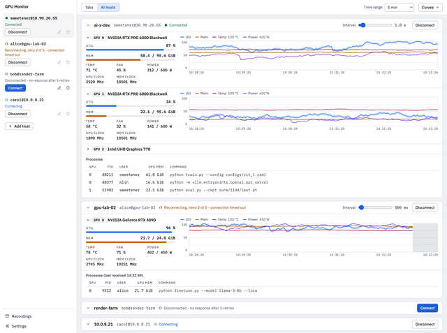

# gpumon

gpumon is a desktop GUI application for Windows and macOS that monitors the GPUs of remote Linux hosts over SSH. It shows utilization, memory, temperature, power draw, and per-process usage in real time, in a layout similar to `nvtop`.

These are design mockups, not screenshots of the running program.

## Features

- **No root required.** A regular user account with SSH access is enough.
- **Nothing to install on the remote host.** The application uploads a single executable to the remote host. It does not depend on `nvtop`, `nvidia-smi`, or any other tool.
- **No remote daemon.** The remote program runs only while the SSH connection is open. It installs no service and leaves no background process.
- **Multiple vendors.** NVIDIA (NVML), AMD (sysfs), and Intel (sysfs / fdinfo).
- **Multiple hosts.** One application window can monitor one or more hosts.
- **Fine-grained sampling.** Every host is sampled every 200 ms. The charts zoom smoothly from 1 minute to 24 hours with the toolbar buttons, Ctrl or ⌘ plus the scroll wheel, or a trackpad pinch.
- **Non-intrusive.** The application does not change any system setting on the remote host.
- **No stored passwords.** Login passwords and key passphrases are never written to disk or to the operating system's credential store.

## Requirements

Local machine:

- Windows (amd64) or macOS (arm64).

Remote host:

- Linux x86_64 with glibc. Distributions that use musl, such as Alpine Linux, are not supported.
- SSH login with a regular user account.
- A home directory that is writable and executable. The remote program is placed in `~/.gpumon/`.

## Tested GPUs

- NVIDIA RTX PRO 6000 Blackwell Workstation Edition
- Intel UHD Graphics 770 (Raptor Lake-S GT1)

## License

gpumon is released under the MIT License. See [LICENSE.md](LICENSE.md).
